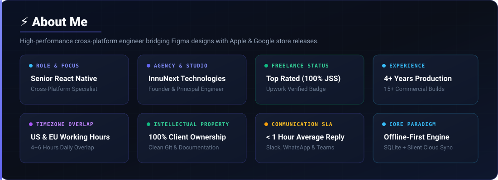
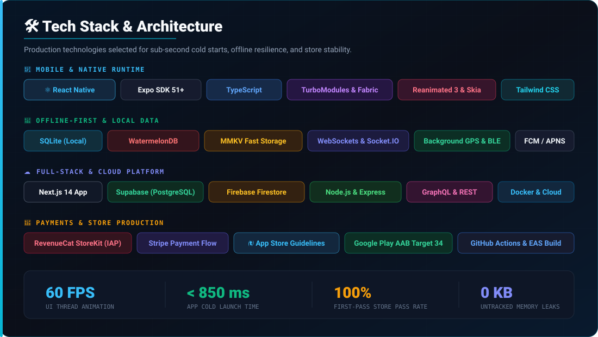
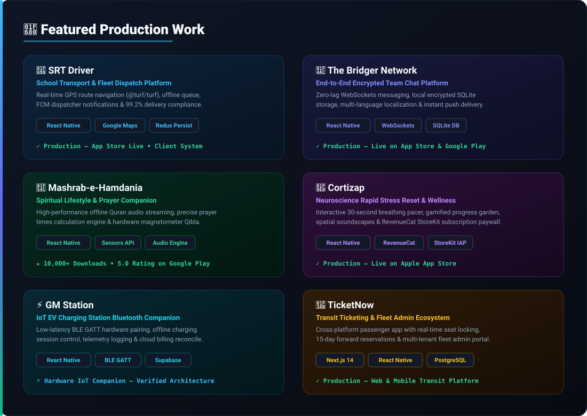
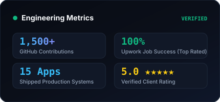
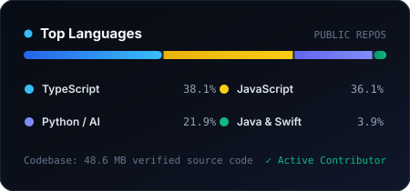
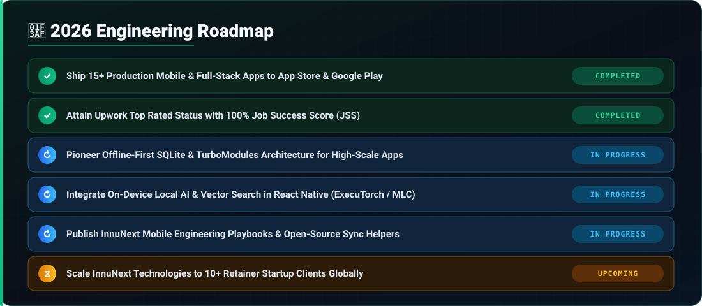
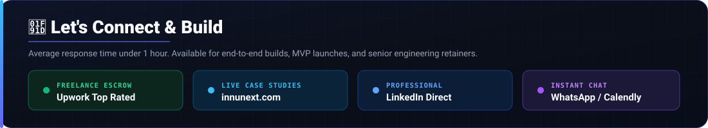

 

&nbsp;

&nbsp;

&nbsp;

 

  

 

 

  

 

 

  

 

> 👉 [Inspect all 15 Interactive Case Studies on innunext.com](https://innunext.com/#projects)

 

  

 

## 📊 Verified Engineering & Language Stats

  
  &nbsp;&nbsp;
  

 

  

 

  

 

## 📈 Activity Graph

  

<b>📅 View Last 3 Months</b>

 

  

<b>🗓️ View Whole Year Graph</b>

 

  

<b>⏪ Monthly Activity History</b>

 

  
    
  
    
  

 

  

 

## 🐍 Contribution Snake

<picture>
  <source media="(prefers-color-scheme: dark)" srcset="https://raw.githubusercontent.com/Inayat567/Inayat567/output/github-snake-dark.svg">
  <source media="(prefers-color-scheme: light)" srcset="https://raw.githubusercontent.com/Inayat567/Inayat567/output/github-snake.svg">
  
</picture>

 

  

 

## 💬 What Founders & Leads Say

<table>
  <tr>
    <td width="33%" valign="top">
      ★★★★★  
      <i>"Inayat went above and beyond when we needed to hit an important deadline. Very reliable, highly skilled technically, and quick to solve issues and implement features."</i>
        
      <strong>Zanni Sabev</strong> 
      Business Owner, Bulgaria • <a href="https://www.upwork.com/freelancers/~01f9a28f1fe989e240">Verified on Upwork</a>
    </td>
    <td width="33%" valign="top">
      ★★★★★  
      <i>"He handled complex challenges with ease, communicated clearly, and delivered a clean, high-quality product that exceeded expectations. A true professional."</i>
        
      <strong>Akshaj Jois</strong> 
      Engineering Lead • <a href="https://www.linkedin.com/in/inayatalii/">Verified on LinkedIn</a>
    </td>
    <td width="33%" valign="top">
      ★★★★★  
      <i>"His technical expertise, problem-solving mindset, and attention to detail are evident in every part of the final product. Highly recommended for any serious mobile build."</i>
        
      <strong>Peter</strong> 
      Product Owner, United States • <a href="https://www.upwork.com/freelancers/~01f9a28f1fe989e240">Verified on Upwork</a>
    </td>
  </tr>
</table>

 

  

 

 

  

 

## 📚 Production Engineering Playbooks

Field-tested architecture guides authored from shipping and rescuing real-world mobile applications:

* ⚡ [**How to Fix React Native Lag, Memory Leaks & Hit 60 FPS in Production**](https://innunext.com/guides/fix-react-native-memory-leaks-60fps/)
* 🛡️ [**Apple App Store & Google Play Submission Checklist: Preventing Rejections**](https://innunext.com/guides/apple-app-store-google-play-rejection-checklist/)
* 🚀 [**Founder's Blueprint: Building Scalable Apps with Expo & New Architecture**](https://innunext.com/guides/react-native-expo-new-architecture-mvp-guide/)
* 📦 [**Architecting Offline-First Mobile Apps with SQLite & Supabase**](https://innunext.com/guides/offline-first-mobile-architecture-sqlite-supabase/)

 

  

 

&nbsp;

&nbsp;

&nbsp;

&nbsp;

&nbsp;

 

💡 <i>"Code is like humor. When you have to explain it, it's bad."</i> — Cory House

 

