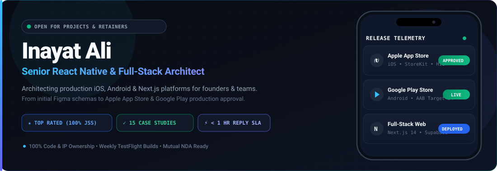
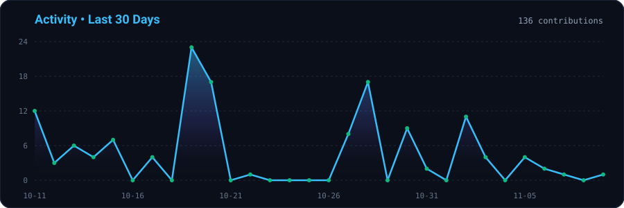
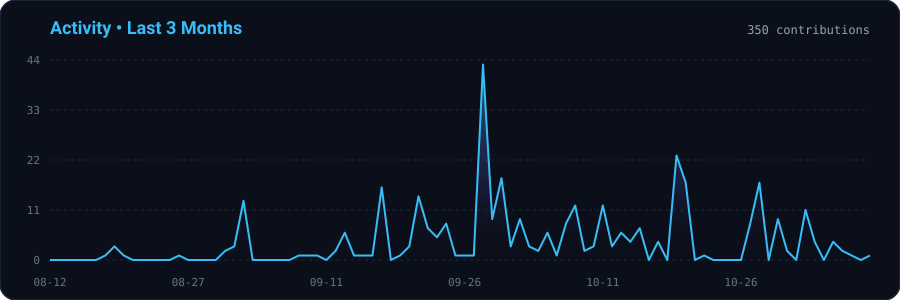
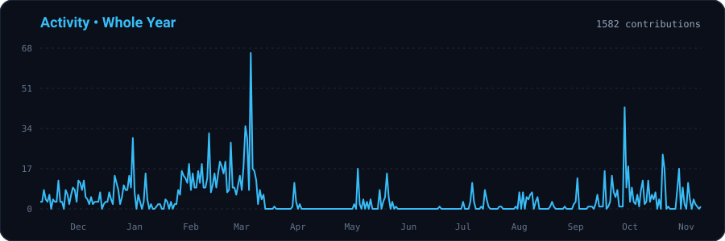
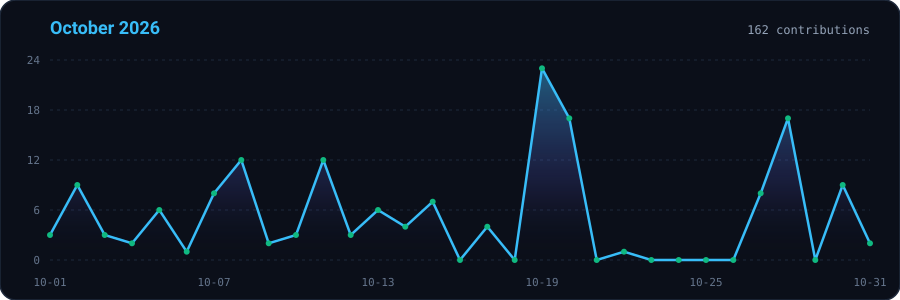
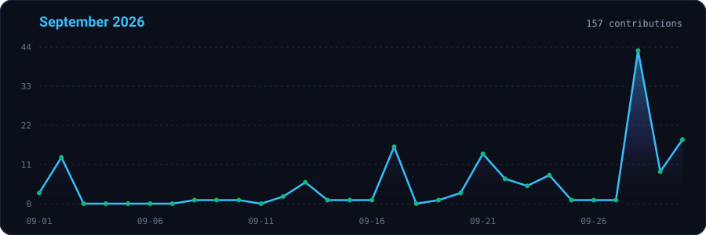
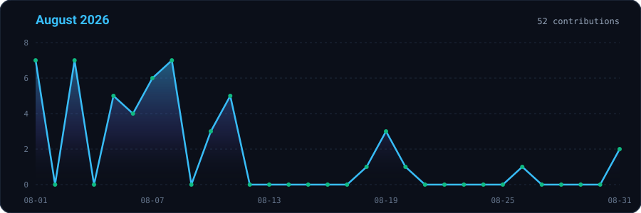

<div align="center">
  <a href="https://innunext.com" target="_blank" rel="noopener noreferrer">
    
  </a>
</div>

<div align="center">
  <a href="https://innunext.com">
    
  </a>
</div>

<div align="center">
  
  &nbsp;
  
  &nbsp;
  
  &nbsp;
  
  &nbsp;
  
</div>

<br/>

<div align="center">
  
</div>

<p align="center">
  <a href="https://wa.me/923555369567?text=Hi%20Inayat%2C%20I%27d%20like%20to%20discuss%20a%20mobile%2Fweb%20project.">
    
  </a>
  &nbsp;
  <a href="https://calendly.com/inayatalibalti100/30min">
    
  </a>
  &nbsp;
  <a href="https://innunext.com/#projects">
    
  </a>
  &nbsp;
  <a href="https://www.upwork.com/freelancers/~01f9a28f1fe989e240">
    
  </a>
</p>

<div align="center">

| 🏆 Upwork Status | ⭐ Client Satisfaction | 📱 Production Case Studies | ⚡ Response SLA |
| :---: | :---: | :---: | :---: |
| **Top Rated (100% JSS)**<br><sub>Top 1% Global Freelancer</sub> | **5.0 / 5.0 Stars**<br><sub>Verified Client Reviews</sub> | **15 Production Builds**<br><sub>iOS, Android & Next.js</sub> | **&lt; 1 Hour Avg Reply**<br><sub>Direct to Lead Architect</sub> |

</div>

<br/>

<div align="center">
  
</div>

<br/>

## 🛠️ What I Architect & Deliver

<table width="100%">
  <tr>
    <td width="50%" valign="top">
      <h3>📱 Mobile App Engineering</h3>
      <ul>
        <li><strong>Cross-Platform Fluidity:</strong> iOS & Android from a single TypeScript codebase using React Native & Expo SDK 51+ (New Architecture Fabric + TurboModules).</li>
        <li><strong>Real-Time Systems:</strong> Live GPS background tracking, geofenced navigation (@turf/turf), WebSockets chat, and WebRTC audio/video calling.</li>
        <li><strong>Hardware & Sensors:</strong> Bluetooth Low Energy (BLE) GATT telemetry, EV charging companion protocols, and camera QR scanning.</li>
        <li><strong>Offline-First:</strong> Zero-data-loss local SQLite / WatermelonDB sync with persistent idempotent mutation outboxes.</li>
      </ul>
    </td>
    <td width="50%" valign="top">
      <h3>🌍 Full-Stack Web & Cloud</h3>
      <ul>
        <li><strong>Scalable Web Platforms:</strong> Next.js 14 (App Router), React, Tailwind CSS, and TypeScript admin portals.</li>
        <li><strong>Cloud Backends:</strong> Supabase (PostgreSQL + Row-Level Security + Edge Functions) and Firebase Realtime Database.</li>
        <li><strong>Monetization & Payments:</strong> RevenueCat StoreKit in-app purchases, Stripe Checkout, and PayPal webhooks.</li>
        <li><strong>Store Release & Compliance:</strong> End-to-end Apple App Store & Google Play submissions, Privacy Manifests, and rejection troubleshooting.</li>
      </ul>
    </td>
  </tr>
</table>

---

## 🤝 How a Project Starts (Transparent & Low-Risk)

```
[ Step 1: Scope & NDA ] ──────> [ Step 2: Milestone Roadmap ] ──────> [ Step 3: Weekly Builds & Launch ]
  Mutual NDA ready                24-hr milestone breakdown             Weekly TestFlight builds
  Figma / wireframe review        Clear deliverables & SLA              100% source code & IP ownership
```

* **Direct 1-on-1 Access:** You work directly with the senior engineer writing your code—zero agency markups, zero middleman hand-offs.
* **Flexible Engagement:** Milestone-based contracts or monthly retainers via Stripe Invoicing, Deel, Wise Business, or Upwork Direct.
* **Global Overlap:** 4 to 6 hours daily overlap for US, European, and Asian client syncs.

<br/>

<div align="center">
  
</div>

<br/>

## 🚀 Selected Production Case Studies

<div align="center">

| Project | Platform | Key Architecture Highlights | Links |
| :--- | :---: | :--- | :---: |
| **SRT Driver** | `iOS` `Android` | Real-time fleet GPS tracking, geofenced turn-by-turn routing, offline Redux Persist queue, and FCM dispatch notifications with 99.2% delivery compliance. | [ App Store](https://apps.apple.com/us/app/srt-driver-app/id6757174613) • [Case Study](https://innunext.com/projects/srt-driver/) |
| **The Bridger Network** | `iOS` `Android` | End-to-end encrypted team chat, local SQLite caching, multi-language localization, and instant push delivery via APNs/FCM. | [ App Store](https://apps.apple.com/au/app/the-bridger-network/id6756187446) • [▶ Google Play](https://play.google.com/store/apps/details?id=com.thebridgernetwork.app) • [Case Study](https://innunext.com/projects/the-bridger-network/) |
| **Mashrab-e-Hamdania** | `Android` | High-performance offline spiritual companion with 10,000+ downloads, 5.0 rating, offline Quran audio, and magnetometer Qibla compass. | [▶ Google Play](https://play.google.com/store/apps/details?id=com.in.mashrabehamdania) • [Case Study](https://innunext.com/projects/mashrab-e-hamdania/) |
| **Cortizap** | `iOS` | Neuroscience wellness app with 30-second rapid stress resets, interactive breathing pacing, and RevenueCat subscription tiers. | [ App Store](https://apps.apple.com/us/app/cortizap/id6749543209) • [Case Study](https://innunext.com/projects/cortizap/) |
| **GM Station** | `Hardware IoT` | EV charging hardware companion connecting via Bluetooth Low Energy (BLE) GATT for offline session telemetry and Supabase billing sync. | [Case Study](https://innunext.com/projects/gm-station/) |
| **TicketNow** | `Web & Mobile` | Unified cross-platform transit booking engine with interactive seat locking, 15-day reservations, and an enterprise fleet admin portal. | [Case Study](https://innunext.com/projects/ticketnow/) |

</div>

> ⚡ **In Active Development / Stealth Pilots:** Currently architecting a fleet mobile app for an autonomous robotaxi pilot in the US, an offline EV hardware scanner, and an on-device computer vision app with TensorFlow.js & MediaPipe.  
> 👉 [Explore all 15 Interactive Case Studies on innunext.com](https://innunext.com/#projects)

<br/>

<div align="center">
  
</div>

<br/>

## 📈 Activity Graph

<div align="center">
  
</div>

<details>
<summary><b>📅 View Last 3 Months</b></summary>
<br/>
<div align="center">
  
</div>
</details>

<details>
<summary><b>🗓️ View Whole Year Graph</b></summary>
<br/>
<div align="center">
  
</div>
</details>

<details>
<summary><b>⏪ Monthly Activity History</b></summary>
<br/>
<div align="center">
  
  <br/><br/>
  
  <br/><br/>
  
</div>
</details>

<br/>

<div align="center">
  
</div>

<br/>

## 🐍 Contribution Snake

<div align="center">
<picture>
  <source media="(prefers-color-scheme: dark)" srcset="https://raw.githubusercontent.com/Inayat567/Inayat567/output/github-snake-dark.svg">
  <source media="(prefers-color-scheme: light)" srcset="https://raw.githubusercontent.com/Inayat567/Inayat567/output/github-snake.svg">
  
</picture>
</div>

<br/>

## 📊 Performance & Language Stats

<div align="center">
  
  &nbsp;&nbsp;
  
</div>

<br/>

<div align="center">
  
</div>

<br/>

## 💬 What Founders & Leads Say

<table>
  <tr>
    <td width="33%" valign="top">
      ★★★★★<br><br>
      <i>"Inayat went above and beyond when we needed to hit an important deadline. Very reliable, highly skilled technically, and quick to solve issues and implement features."</i>
      <br><br>
      <strong>Zanni Sabev</strong><br>
      <sub>Business Owner, Bulgaria • <a href="https://www.upwork.com/freelancers/~01f9a28f1fe989e240">Verified on Upwork</a></sub>
    </td>
    <td width="33%" valign="top">
      ★★★★★<br><br>
      <i>"He handled complex challenges with ease, communicated clearly, and delivered a clean, high-quality product that exceeded expectations. A true professional."</i>
      <br><br>
      <strong>Akshaj Jois</strong><br>
      <sub>Engineering Lead • <a href="https://www.linkedin.com/in/inayatalii/">Verified on LinkedIn</a></sub>
    </td>
    <td width="33%" valign="top">
      ★★★★★<br><br>
      <i>"His technical expertise, problem-solving mindset, and attention to detail are evident in every part of the final product. Highly recommended for any serious mobile build."</i>
      <br><br>
      <strong>Peter</strong><br>
      <sub>Product Owner, United States • <a href="https://www.upwork.com/freelancers/~01f9a28f1fe989e240">Verified on Upwork</a></sub>
    </td>
  </tr>
</table>

<br/>

<div align="center">
  
</div>

<br/>

## 📚 Production Engineering Playbooks

Field-tested architecture guides authored from shipping and rescuing real-world mobile applications:

* ⚡ [**How to Fix React Native Lag, Memory Leaks & Hit 60 FPS in Production**](https://innunext.com/guides/fix-react-native-memory-leaks-60fps/) — JSI, MMKV, FlashList vs FlatList, and Reanimated UI-thread worklets.
* 🛡️ [**Apple App Store & Google Play Submission Checklist: Preventing Rejections**](https://innunext.com/guides/apple-app-store-google-play-rejection-checklist/) — Account deletion compliance, Privacy Manifests, and StoreKit paywalls.
* 🚀 [**Founder's Blueprint: Building Scalable Apps with Expo & React Native New Architecture**](https://innunext.com/guides/react-native-expo-new-architecture-mvp-guide/) — Why startups ship 2x faster with TypeScript cross-platform foundations.
* 📦 [**Architecting Offline-First Mobile Apps with SQLite, WatermelonDB & Supabase**](https://innunext.com/guides/offline-first-mobile-architecture-sqlite-supabase/) — Zero-data-loss field operations with idempotent mutation outboxes.

<br/>

<div align="center">
  
</div>

<br/>

## 🧰 Tech Arsenal & Integrations

<p align="center">
  
</p>

<div align="center">

| Category | Technologies & Native Integrations |
| :--- | :--- |
| **Mobile Core** | React Native, Expo SDK (EAS Build / Update), Fabric & TurboModules (JSI), TypeScript |
| **State & Storage** | Redux Toolkit, Redux Persist, Zustand, MMKV (Synchronous JSI), SQLite, WatermelonDB |
| **Real-Time & Hardware** | WebSockets (Socket.io), WebRTC VoIP Calling, Bluetooth Low Energy (BLE), Background Geolocation |
| **Cloud & APIs** | Next.js 14, Supabase (PostgreSQL + RLS), Firebase, RESTful APIs, GraphQL, Node.js / Express |
| **Monetization & Auth** | RevenueCat (StoreKit + Play Billing), Stripe, Apple Sign-In, Google OAuth, Phone OTP |
| **Testing & Tooling** | Jest, React Native Testing Library, Flipper, Sentry, Bugsnag, GitHub Actions CI/CD |

</div>

<br/>

<div align="center">
  
</div>

<br/>

## 📬 Start a Project or Codebase Audit

Have a new product idea, a Figma prototype, or an existing React Native app that needs performance tuning or store publishing? Let's talk.

<p align="center">
  <a href="https://wa.me/923555369567?text=Hi%20Inayat%2C%20I%27d%20like%20to%20discuss%20a%20mobile%2Fweb%20project.">
    
  </a>
  &nbsp;
  <a href="mailto:inayatalibalti100@gmail.com">
    
  </a>
  &nbsp;
  <a href="https://calendly.com/inayatalibalti100/30min">
    
  </a>
  &nbsp;
  <a href="https://www.upwork.com/freelancers/~01f9a28f1fe989e240">
    
  </a>
</p>

<p align="center">
  <a href="https://innunext.com"><strong>Portfolio Website</strong></a> • 
  <a href="https://www.linkedin.com/in/inayatalii/"><strong>LinkedIn</strong></a> • 
  <a href="https://contra.com/inayat_ali"><strong>Contra</strong></a> • 
  <a href="https://www.fiverr.com/inayatalidev"><strong>Fiverr</strong></a> • 
  <a href="https://stackoverflow.com/users/12970547/inayat-ali"><strong>Stack Overflow</strong></a>
</p>

<div align="center">
  <sub>© Inayat Ali • Founder &amp; Lead Architect @ <a href="https://innunext.com">InnuNext Technologies</a></sub>
</div>
